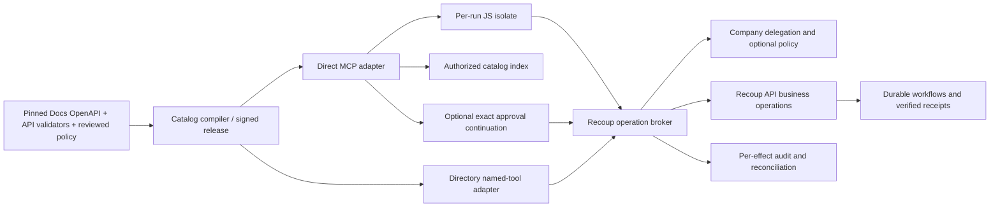

# Recoup MCP code mode

**Proposed technical specification · November 27, 2026 · [Delivery epic](https://github.com/recoupable/mono/issues/751)**

Under this design a Recoup Records owner can appoint an agent to run the label. The agent can take a one-off assignment or follow standing company instructions. With full delegated authority it can act immediately, through two direct MCP tools. `search` finds the relevant Recoup operations. In `execute`, the host’s model writes a short JavaScript program, reads the records it needs, calls the Recoup API to make changes, and obtains evidence of what happened. The API owns the business rules for every client.

The product target is every music-company operation a human with equivalent authority can perform. Each missing API action, provider integration or independently verifiable outcome has an owner in the coverage inventory. A company can delegate the full operating role once, narrow it, or require individual approval for specified actions. New personal connections retain their own expressly granted access. The optional instruction and approval features, first-party App migration and public ChatGPT Directory submission have independent delivery paths.

| Read next | What it establishes |
| --- | --- |
| [Measured current architecture](mcp-code-mode-baseline.md) | Source pins, real SDK discovery across profiles, host inventory, product semantics and prior publisher work |
| [Company delegation and the first label workflow](mcp-code-mode-autonomy.md) | One-off and standing assignments, company authority, policy decisions, a verified catalog-case change and restart after disconnect |
| [Code-mode research](mcp-code-mode-research.md) | Cloudflare, Anthropic and Executor source, host deferral, runtime alternatives and comparative evaluation |
| [Protocol and OpenAI review](mcp-code-mode-protocol.md) | Current MCP and extensions, negotiated capabilities, eight proposed reviewer scenarios, submission and updates |
| [Proposed tool descriptors](mcp-code-mode-tools.json) | Measurable example input/output contracts for a direct connection |
| [Delivery and dependencies](#delivery-and-dependencies) | Owning repositories, parallel work, release gates and GitHub issues |

## Decision and measurable outcome

Full delegated OAuth returned 95 descriptors in the measured modern SDK fixture, including 94 visible to the model. They took 31,971 wire-list tokens and 31,820 model-visible descriptor tokens. The proposed two-tool read-only profile takes **813** reference tokens (3,347 bytes). The two-tool profile that lets an agent act takes **1,017** (4,189 bytes), a **96.8% reduction** against that full model-visible baseline. Enabling the optional approval continuation takes **1,397** (5,734 bytes) across three tools. Narrow OAuth already measured 1,038 visible tokens. Storage, model prompts, actual startup and task cost are separate measurements.

Run the [schema and size verifier](verify-mcp-code-mode.py) from the API repository. It builds the three wire profiles from the [fixture](mcp-code-mode-tools.json), serializes each compact `tools/list` envelope in UTF-8 with no trailing newline and uses tiktoken 0.14.0 with `o200k_base`. Its internal `actRequest` schema stays off the wire. Compare actual prompt traffic under equal host, grant, task, tools-deferred setting, server instructions and preloaded resources. [Measured baseline and reproduction](mcp-code-mode-baseline.md)

| Distribution | Proposed route on api.recoupable.dev | Model and wire contract |
| --- | --- | --- |
| Direct, read-only | `/mcp/code` | Exactly `search` and `execute`. Native skills/resources use negotiated protocol methods. Text-only hosts can find permitted skills through search. |
| Direct, company-authorized | `/mcp/code` | Exactly `search` and `execute` for an agent that can act unattended. An allowed `recoup.act` inside `execute` applies the requested change. An approval-enabled profile may also expose `commit` to finish one exact parked effect. Truthful annotations describe the effects reachable on each profile. |
| OpenAI Directory | `/mcp/directory` | Initially `select_catalogs` and `select_catalog_songs` only. Each has its own reviewable schema, effect metadata and implementation. Introduce a separate catalog-read permission. The Directory endpoint cannot route to the guest, discover implementation IDs, call commit or load skills that promise unavailable functionality. |
| Existing installs | `/mcp` and the existing staff skills endpoint | Preserve current authentication, scopes, gallery, legacy names and selected-context behavior. The existing thread launcher and app-only sidebar count separately. Qualify their replacement independently before retiring those entry points. |

Both new URLs are proposals under the established MCP mount. Business REST endpoints retain their /api paths. Keep scheme, host and port for the Directory publisher. Profile routing is a server decision bound to the endpoint and expected OAuth resource. Ignore brand strings as authorization selectors. A discovered operation is a description, never permission to call it. OpenAI requires separately exposed model-callable operations for Directory review. Recoup previously split its opaque Context tool into named operations after a scan. Changing the same endpoint under an existing publisher draft would risk both review and installed clients. [OpenAI §6.2](https://developers.openai.com/plugins/plugin-guidelines#62-tool-independence-and-exposure) · [Recoup's prior review fix](https://github.com/recoupable/api/pull/980)

## Alternatives and cutover strategy

| Option | Strength | Decision |
| --- | --- | --- |
| Keep named tools and use lazy host discovery | Minimal server migration. Preserves action-specific schemas, built-in confirmation and UI. | Ship named tools for Directory. Benchmark native deferral on supported clients. Direct clients need portable composition and bounded intermediate results. |
| Search, then register named tools dynamically | Fast single-step calls in cooperative clients. | Catalog changes can race across calls and vary by host. Adds discovery state and leaves multi-step results in the prompt. |
| Two generic tools calling arbitrary REST paths | Small interface. Easy to generate from OpenAPI. | REST authentication, side effects and output semantics differ from delegated MCP. A path allowlist cannot express selected context, quoting or response projection. |
| Prepare every write and require individual confirmation | Gives a person an opportunity to inspect each change. | Offer exact review where the company chooses it or the transaction requires it. Requiring this for routine delegated work would prevent an agent from running the label unattended. |
| Two direct tools, an API-owned authorization decision, an optional approval continuation and named Directory tools | Stable discovery cost as operations grow. The same API checks and receipts cover autonomous and individually approved work. | **Adopt.** The API owns behavior. An interchangeable runner composes its operations. Optional modules provide standing assignments, approval journeys and durable scheduling. |
| Adopt Executor as the platform, translate everything to CLI, or run another LLM inside MCP | Rapid access to a broad framework or familiar developer surface. | Executor's discovery/dispatch design is applicable. Its account, deployment and distribution model would duplicate Recoup's. CLI/inner-model approaches add shell or model dependencies to ordinary MCP clients. |

Use parallel opt-in URLs, with independent flags by profile, operation and cohort. Compare equivalent reads with test fixtures or consented canaries. Never shadow a write, paid provider call, secret read or outbound delivery. A big-bang swap at `/mcp` would strand installed hosts, invalidate the publisher contract and obscure regressions.

## Components and ownership



**Catalog compiler, API repository.** Compile approved descriptors and server-only bindings during CI. The Docs repo owns the split OpenAPI files, operation IDs and operation inventory. Pin the Docs commit, its upstream API source commit and hashes, then reconcile with the API build's actual routes, validators and services. The inspected Docs revision classifies 442 method/path rows in its source inventory and pins 14 specification hashes. The rows include 217 public, 17 public/integration, 177 internal, 13 internal/callback, 14 pending and four legacy entries. The static registration inventory has 75 entries, a separate measure from the 95-item full OAuth discovery response. Never enable a capability merely because Docs documents a route. Refresh drift as a proposed catalog diff requiring review. [Docs inventory](https://github.com/recoupable/docs/blob/873a1c93cf6ae0060702e38eba1b2715bb269f42/content/docs/contracts/operation-inventory.json) · [Docs publication workflow](https://github.com/recoupable/docs/blob/873a1c93cf6ae0060702e38eba1b2715bb269f42/AGENTS.md) · [Related capability-manifest work](https://github.com/recoupable/app/issues/2223)

**Versioned operation record.** Each record has a stable domain ID, public aliases, owner, revision, title, search terms, typed input, validated output and short example. The private binding selects a specific REST operation ID or shared domain method, HTTP serialization when needed, authorized identity and resource resolvers, selected-context projection, field mask, processor and destination classes, effects including delayed effects, budget/quote rules, idempotency, async lifecycle and per-profile disposition. A multiplexed REST operation needs an action-specific binding with a fixed discriminator. Link each published operation and legacy alias to contract tests. Emit per-profile manifests, TypeScript declaration snippets, searchable summaries and Directory descriptors as projections of that one record.

**Runtime release.** Content-address the manifest using canonical JSON over the API/Docs pins, schemas, bindings and policy. Sign it in CI, verify before serving, and record the digest on calls and receipts. Keep immutable revisions available for lookups and in-flight reconciliation. Changing a decision from allowed to denied takes effect immediately, even on an older pinned revision. A request with a retired schema returns `catalog_changed` with a rediscovery instruction. Keep aliases for backward-compatible changes, and use a new operation version for incompatible inputs, outputs or effect semantics. Include the old/new diff in approval and Directory review. No network fetching of arbitrary schema references at runtime.

**Operation broker, API repository.** Both profiles invoke the same business code. Prefer a typed in-process service invocation after the route's and profile's authorization/ownership checks have been composed. A fixed-origin HTTP binding is acceptable where the owning API supports the precise audience, identity, scope and effect contract. Resolve method, path and allowed headers server-side. Pass no host-managed MCP bearer to REST. Do not mint an account API key, assign a caller-supplied owner ID or substitute an admin credential. Refactor a handler into an authorized service or leave its operation unavailable if these conditions cannot be met.

**Human workflow coverage.** Work available only to a human in the App, a provider portal or a manual back office gets a parity entry with its real owner, present limitation and readback criterion. Build missing company capabilities once in that owner’s API service. Preserve genuine provider and legal participation requirements, with a named continuation path. Directory exposure and support for a particular host are separate inventory columns. Compare human and agent outcomes on equivalent permissions and data.

**Runner.** Qualify an isolated Cloudflare Dynamic Worker first. Keep the front door, authentication, sensitive projections, approvals, receipts and business services in Recoup's API. The supervisor gets a short-lived, single-run channel to the broker, mutually authenticated and bound to the request, release and budget. Only the supervisor holds channel credentials. The guest sees two host functions and structured-cloned values. It gets no OAuth/session tokens, raw HTTP client, network, file access, environment, dynamic module loading, shell or database connection. Apply the platform's outbound-deny configuration at instantiation. The private broker accepts a typed RPC and a current run binding only. Review third-party processing, region, retention and contractual suitability for every data class crossing this boundary. If the first runner fails a hard gate, benchmark a per-run Vercel Sandbox through the same port. Keep launch off until one adapter meets the gates. [Runtime comparison and primary sources](mcp-code-mode-research.md)

## Interaction contract

`search` accepts a natural-language query, exact ID or page cursor. Each result has an id, summary and effect. Operations carry read or write, while skill material carries instruction. Requested contract sections and skill files use the optional bounded detail object. An exact lookup supplies input, output, one runnable example, authorization prerequisites, cost, pagination and revision. Rank exact IDs and aliases first, then domain terms and deterministic lexical matches. Add semantic reranking only if a measured query set improves without leaking unauthorized metadata or regressing exact matches. Limit summaries to eight and 4 KiB per response. Exact schemas may page by section at 12 KiB. A signed cursor binds selection, query, principal, policy and expiry. Reject mixed modes and invalid file paths. Skill fallback resolves only accessible skill IDs/files using the existing audience resolver. Use the same denial for hidden and unknown IDs.

`execute` accepts a pinned revision, JS source and separate JSON parameters. The async program receives `recoup.read(id, args)` for qualified effect-free reads. An action-capable connection also supplies `recoup.act(id, args, {requestKey})`. For the action profile the caller supplies a stable run `requestKey` with every source program, and one stable per-step key per distinct effect. Persist the run before dispatch. The same key and digest return the previous run. A different request with that key conflicts. `execute({requestKey})` and `execute({runId})` look up authorized status without running source again. A guarded `execute({runId,resume:true})` continues only a recorded checkpoint. Ordinary completed read-only computations need no durable account artifact. Bind action outputs to broker receipts independently of the guest’s chosen return value, including if it throws, times out or returns a misleading value.

After admitting an action run, return its durable run ID even on overall failure. On status lookup by run ID or original request key, the broker supplies a bounded, authorized per-step record in `value` with the step ID, outcome, receipt reference and any permitted independent readback reference. Those records remain available if two changes succeeded and a later line of the program failed. The guest cannot overwrite them. A short run has at most 16 steps. Longer jobs retain checkpoint and child-run references in the owning workflow.

For example, an account asks for the first five track titles in one of its catalogs. Searching for “my catalogs and track list” yields the qualified metadata projections below. The model can combine them without putting the catalog rows in the chat. The account has already selected a catalog ID. Display names can collide across organizations. These IDs and normalized fields are **proposed**; the existing MCP matcher has a different contract.

```js
async (recoup, params) => {
  const { catalogs } = await recoup.read("catalogs.listOwned", { ids: [params.selectedCatalogId] });
  const catalog = catalogs.find(item => item.id === params.selectedCatalogId);
  if (!catalog) return { found: false, tracks: [] };
  const page = await recoup.read("catalogs.listTrackMetadata", { catalogId: catalog.id, limit: 5 });
  return { found: true, tracks: page.tracks.map(track => track.title), hasMore: page.hasMore };
}
```

The proposed ID filter returns only owned matches and can be applied before paging. For an initial name-only request, page the authorized list and ask for a choice if multiple catalogs match. Test duplicate names and later-page matches. The catalog owner path is derived from the connection. The track metadata binding checks catalog access before fetching a page and only returns approved metadata. The proposed Directory matcher instead accepts a brief, can send metadata to a known AI processor and returns actual matching tracks from a bounded search window. It needs its own adapter, privacy disclosure and qualification. Each named Directory operation works independently for an authorized account. [Current mapper](../../lib/mcp/tools/catalogs/registerGetCatalogSongsTool.ts)

For a direct assignment, an appointed agent can find the current metadata observation and private case operations, read the evidence, create or update a case with `recoup.act` and reopen it independently. The authenticated company and selected catalog come from the connection. Stable internal recording identity, correction kind and company identify the same business work across chats and retries. A name collision, missing ISRC or partial source cannot establish identity. This proposed case grant needs API work. A smaller first dispatch can use the existing additive `review_context_release_case` operation with `needs_changes` on qualified evidence, then independently read the immutable review. The catalog-correction workflow demonstrates continued operation after chat closure. [Case contracts](../../lib/context/releaseCaseOperationSchemas.ts) · [Installed acceptance](mcp-code-mode-autonomy.md#installed-end-to-end-acceptance)

**Authority and dispatch.** The owner appoints a named, revocable company agent with full or selected operating authority. A grant can cover qualified future actions in an authorized role and domain if the owner explicitly selects that behavior. Show material scope/effect changes and require a fresh grant for an expanded audience, role, data boundary or ungranted capability. Company membership, a saved instruction, program source or provider account access alone cannot appoint the agent. With no optional policy the API uses the explicit grant and the operation’s own requirements. With a configured policy, evaluate active company rules as well. `allow` dispatches immediately. `requires interaction` parks the exact effect with an actionable reason. `deny` dispatches nothing. Denial takes precedence, then required approval, then allow. If a configured policy is unavailable, hold affected effects. An absent optional module never delays a properly granted action. Recheck authority on every operation, checkpoint and dispatch. [Full contract](mcp-code-mode-autonomy.md)

**Optional exact approval.** When the company requests individual confirmation, the broker seals a canonical one-effect intent bound to actor, grant, company, selected resource, operation and policy revisions, destination, quote or ceiling, expiration and input digest. For a company approval return `approval_required` with the run ID and a broker-derived URL for the exact receipt. Include the sealed intent for the caller only on a profile that exposes `commit`. Build it from the fixed HTTPS Recoup App origin, path and server-issued ID. The signed-in App at `https://app.recoupable.dev/mcp/approvals/{runId}` presents the target, change, destination, charge and expiry to an authorized approver. Validate exact URL equality before every response and test login and sign-in return at the canonical origin. Accept a trusted, bound decision before `commit({intent,requestKey})` dispatches that effect once. It cannot substitute arguments or approve another step. Recovery via `execute` reads the same receipt and, where supported, resumes a saved checkpoint after the effect is settled. Limit canonical arguments to 4 KiB and sealed intent to 8 KiB for this optional interface. Refuse oversized pending approval inputs before dispatch and supply narrowing guidance. Quotes that reserve credits or send data have their own effect contracts. An external signature or provider consent needs proof from its issuer. [Existing production consent origin](../mcp-oauth-runtime.md)

The read-only `execute` annotation applies only to a bridge that cannot cause effects, including hidden settlements or paid processing. For action-enabled `execute` and optional `commit`, compute open-world, destructive and idempotency hints conservatively from all reachable operations. A full direct role can reach external effects once its API operations are qualified. Authorize the destination and fields against the company grant, provider contract and configured policy. A tool annotation does not authorize transfers. Qualify actual host confirmation behavior separately. A client that forces per-call prompts cannot serve as the unattended operating host for that workflow.

### Large results, media and extensions

A modern client can receive a structured result, a scoped resource link or an existing host attachment when its adapter supports the type. Keep binary media, private audio, fan contacts, provider dataset IDs and service credentials out of the default JS projection. For a private artifact return an opaque reference bound to actor, grant, resource class and expiry, with a documented MIME type and retrieval limit. Validate access again on dereference. Legacy text-only hosts receive a bounded summary and an authorized follow-up path. Never fall back from a private file to a public media URL. A directory or skill resource cannot execute an operation or broaden a grant. Keep the existing gallery on its qualified profile until supported thread/sidebar behavior, CSP and scoped assets survive installation tests. Native Tasks and streaming can improve UX later without changing Recoup run IDs or persistence.

## Budgets, lifecycle and failure behavior

| Proposed initial bound | Enforcement point |
| --- | --- |
| Source 8 KiB UTF-8, params 16 KiB, depth 16; catalog summaries 4 KiB; guest result 16 KiB | HTTP front door counts bytes before parse; broker checks structured payloads before copying. Schema `maxLength` is only an additional character bound. Cap cumulative data returned to guest at 256 KiB per run. |
| 16 nested calls and two simultaneous reads per short run; each action carries its own effect key | Enforce atomic budgets and domain quotas. Multiple allowed effects can execute in sequence and return distinct receipts. A Vercel Workflow owns larger or longer assignments across short runs and preserves partial progress. |
| 10 s wall time, 100 ms guest CPU and an enforced provider memory ceiling, starting target 128 MiB | Hard-stop guest and close callback channel. Qualify actual platform ceilings, cancellation and tail behavior under contention. Allocate broker I/O and processor budgets independently. |
| Optional approval valid for up to 5 minutes or earlier quote/grant expiry | Recheck at decision and dispatch. Status handles require live authorization. A workflow can renew a stale quote or request a fresh decision for changed terms. |
| Sensitive logs | Only trace ID, hashed/opaque tenant and operation identifiers, policy/manifest revision, byte counts, durations, budget, outcome and receipt reference. Omit source, arguments, credentials, prompts, results and raw upstream errors by default. |

Validate audience-specific credentials, client, operating role, current company/artist access, asset ownership, policy and emergency disable on each call. Private caches and signed cursors are scoped to those boundaries. The present `/mcp` audience and legacy API-key/Privy, narrow, full, selected-context and staff connections retain their present access. Add an explicitly appointed company principal and renewable, revocable credential for the new direct audience. Owners can authorize full operating authority during appointment. Personal one-hour read-only agent registration and mere organization membership cannot serve as this grant. Use a separate catalog-read grant for Directory. Activation of equivalent domain services for the new identity requires normal-entry tests. Qualification for one channel cannot change another channel’s credentials. [Current resource metadata](../../lib/oauth/getOAuthResourceMetadata.ts) · [Current agent registration](../agent-registration.md)

Persist only the data necessary to apply or reconcile a write. Use Supabase via its existing repository layer. Define receipt rows with `run_id`, actor/grant/profile, operation/release, intent digest, request key, lease and timestamps, approved ceiling, state, safe result digest/reference, downstream idempotency handle and outcome evidence. Use a unique key for company business key + effect step as well as the actor/profile/request-key binding and any optional sealed intent claim. An identical authorized retry returns the prior receipt. Reusing a key for a different request conflicts. An authenticated receipt records the company delegation and decision basis even when no individual approval exists. Distinct keys cannot consume the same intent twice. Atomically claim/record the ledger and enqueue an outbox entry for service dispatch. Immediately before a queued worker actually dispatches, revalidate grant, membership, kill switch, destination, quote, any required approval and remaining shared budget against the claimed receipt. If any expired during queueing, terminally deny or expire it without an external effect. Test revocation and quote expiry after enqueue. Integrate existing domain transaction/idempotency keys where available. If the upstream cannot deduplicate, a worker crash after dispatch enters reconciliation; never automatically replay that submission.

An allowed action can go straight to accepted. An approval-required action is parked first. Record running, successful, failed and unknown outcomes with independent evidence where possible. A timeout after dispatch yields `unknown_outcome` with a handle. An independent status read resolves it when evidence exists; otherwise retain it for operator reconciliation. An aborted script stops new work. A cancellation after an upstream commit returns known effects. A downstream Recoup REST 202 denotes job acceptance. The MCP tools/call still returns a JSON-RPC result carrying a run handle. A transport-level HTTP 202 without a body acknowledges a notification or response, not an asynchronous tools/call. Long operations use an existing domain job or a Vercel Workflow and an authorized status projection. Never keep a JS isolate resident during human confirmation, long media generation or durable polling. Optional MCP Tasks can project the same underlying receipt for capable clients. Use existing workflows instead of adding Trigger.dev jobs. Define an expiry for payloads, receipts and redacted audit metadata with the product/privacy owner before rollout, and preserve required idempotency records for the entire allowed retry window.

Return structured domain failures with a bounded `code`, `traceId`, retry guidance and a receipt when available. Distinguish invalid arguments, changed catalog, unknown-or-denied operation, expired approval, budget exceeded, upstream busy, partial coverage and unknown outcome. Use MCP tool errors for domain failures and JSON-RPC/HTTP errors for malformed protocol and authentication. For search and failures before a valid result envelope exists, return isError with one bounded JSON text block containing code, retry and traceId. In execute/commit structured results, put code and retry under error. Require runId for approval_required, accepted, running and unknown_outcome. Status reads return the same receipt-state names as commit; complete and partial describe successful guest computations. On approval_required, report the broker-derived URL and authorized run ID. On an approval-enabled profile, execution and receipt lookup also return the exact parked intent. The caller already supplies that intent to commit. A complete guest computation returns a value and truncated=false. The supervisor reports partial when it removes rows or cannot establish coverage; truncated=true always implies partial. A source page with hasMore may still fully answer an explicitly bounded first-page question. Back off and retry a read within its remaining deadline. Never retry an ambiguous external write based on a 5xx alone. If the runner fails, surface unavailable and keep eligible cohorts on their prior connection. Do not fall back to a broader credential or endpoint.

## Qualification, release and expansion

**Test design.** Use test-first domain work and fixtures seeded in two isolated accounts and organizations. Exercise reference resolution, unions, strict schemas, empty results, tenant/role changes, pagination, malformed/oversized programs, quota exhaustion, caller cancellation and new-revision behavior. Compare canonical outputs and effects against the old operation, including “read” calls that can settle a pack, quoted social refresh, restricted recipients, private file handles and scheduled downstream costs. Keep identity-bearing data out of release evidence. Capture installed client name/version, resource audience, tool list, operation/revisions, actual outcome, and independent readback for writes. Benchmark entirely on synthetic or authorized disposable fixtures.

**Proposed release gates.** Measure at least 30 paired runs per task class and model/host treatment where automation is available. Keep seed, model release, prompt, host version, tool selection mode, temperature or supported equivalent, selected grant and data constant. Expand the sample when the interval cannot resolve a gate. Include single reads, empty/unknown, two-step discovery, paged joins, selected context, skill reads, a denied operation, an unattended mutation with zero prompts, a separately configured approval, replay, durable restart and independently verified outcomes. Use matched legacy/host-deferred baselines and include failures in all summaries.

| Gate | Proposed acceptance |
| --- | --- |
| Startup | At most 1,500 descriptor tokens for the write-capable direct profile, at least 90% below full OAuth's model-visible reference list. Verify actual first-turn token delta on controlled hosts and report measured vs unavailable separately. For a narrow/deferred client already below that target, require no material startup or task-success regression before migrating. |
| Correctness and autonomy | All deterministic authorization, projection, optional approval, idempotency and isolation tests pass. Zero unauthorized or duplicate changes. Verify a real human-visible effect with zero per-effect approvals under full delegation and no stored instructions; separately demonstrate the exact number of interactions a configured exception requires. Test two companies, concurrent agents, stale evidence and revocation after enqueue. An unqualified optional branch holds only the cohort or operations depending on it. |
| Model utility | On core tasks, paired success lower 95% confidence bound for candidate minus best applicable baseline ≥ −5 percentage points. Flag each critical task class independently. Human checks for false licensing claims and fabricated tracks. |
| Efficiency | In multi-step reads target ≥30% less median total model-visible token traffic, direct vs eager named. Show deferred baseline too. On single reads target ≤20% p95 wall-time regression and ≤10% higher median cost per correct task vs best compatible baseline. Record cold/warm runtime, processor calls, cache hits and configured approval latency separately. Report cases completed, unresolved cases with reasons, unnecessary interruptions and cost per independently verified business outcome. Track the percentage of existing human workflows with verified agent parity, attributed gaps and an owner for each gap. Hold a default change when cohorts miss targets. |
| Operability | Test failure injection before/after admission, revocation mid-run, stopped runner and restart after dispatch. On a controlled deployment exercise per-operation disable, per-profile rollback and recovery of existing receipts. Establish p95 and cost alarms from measured baselines. |

**Adoption sequence.** Start the inventory and runner qualification in parallel. Test reads to validate connectivity, then dispatch one real additive action for a disposable company through two tools and independently reopen the result, with zero confirmations after appointment. Launch this slice without saved instructions, an approval UI or Directory review. Next qualify an end-to-end label assignment across chat closure and worker replacement, and test optional standing instructions and human review on their own tracks. Eligible direct cohorts can progress through 1%, 10%, 50% and 100% after a monitoring window and successful journeys at each stage. Keep existing installs, historical chat and gallery paths until their own parity and rollback gates pass. Publish the independently named OpenAI package through its existing publisher process.

**Rollback and retirement.** On an isolation, billing, duplicate-effect or cross-account failure, immediately disable the affected operation/profile, stop new dispatch, quarantine uncertain receipts and keep reconciliation available. Preserve older manifests, client settings, old route and status reads. Roll forward schema or policy fixes under a fresh revision. Before communicating an end-of-life date, require a disposition for every old name/shape/client, usage evidence over a proposed 30-day window, host-owner signoff and a working reconnect/restore runbook. Low usage alone does not establish parity. Keep unsupported hosts on legacy if needed. Record rollout, deprecation, review submission, approval and publication as separate milestones.

**Adding a capability after cutover.** A maintainer lands the Docs contract, pins its API binding, adds or changes one operation record with ownership/effects, runs compiler and negative contract fixtures, and opens the generated catalog diff. The broker can then admit it per profile. Direct clients discover it on the next authorized search. A Directory addition generates an independent named descriptor and goes through the current review process. A new sandbox, model or protocol extension can be introduced behind the same contracts and evaluated against the same fixtures.

## Delivery and dependencies

| Ticket | Deliverable | Blocked by |
| --- | --- | --- |
| [api#1303](https://github.com/recoupable/api/issues/1303) | Map human workflows, agent coverage and startup context | Can start now |
| [api#1304](https://github.com/recoupable/api/issues/1304) | Build the API operation catalog and per-channel projections | [api#1303](https://github.com/recoupable/api/issues/1303) |
| [api#1305](https://github.com/recoupable/api/issues/1305) | Appoint, authenticate, renew and revoke company agents | [api#1303](https://github.com/recoupable/api/issues/1303) |
| [api#1306](https://github.com/recoupable/api/issues/1306) | Qualify an isolated JavaScript runner and typed Recoup bridge | Can start now |
| [api#1307](https://github.com/recoupable/api/issues/1307) | Ship search and execute with separate read and action profiles | [api#1304](https://github.com/recoupable/api/issues/1304), [api#1305](https://github.com/recoupable/api/issues/1305), [api#1306](https://github.com/recoupable/api/issues/1306) |
| [database#144](https://github.com/recoupable/database/issues/144) | Persist business keys, dispatch claims, audit and effect receipts | [api#1304](https://github.com/recoupable/api/issues/1304), [api#1305](https://github.com/recoupable/api/issues/1305) |
| [api#1308](https://github.com/recoupable/api/issues/1308) | Dispatch allowed company actions from execute with zero confirmations | [api#1307](https://github.com/recoupable/api/issues/1307), [database#144](https://github.com/recoupable/database/issues/144) |
| [api#1316](https://github.com/recoupable/api/issues/1316) | Expose private catalog-correction cases to company agents | [api#1304](https://github.com/recoupable/api/issues/1304), [api#1305](https://github.com/recoupable/api/issues/1305) |
| [api#1315](https://github.com/recoupable/api/issues/1315) | Continue jobs across chat closure, worker restarts and events | [api#1308](https://github.com/recoupable/api/issues/1308) |
| [api#1313](https://github.com/recoupable/api/issues/1313) | Add optional standing instructions and policy overrides | [api#1305](https://github.com/recoupable/api/issues/1305), [api#1308](https://github.com/recoupable/api/issues/1308) |
| [app#2411](https://github.com/recoupable/app/issues/2411) | Migrate first-party consumers and build the optional approval screen | [api#1307](https://github.com/recoupable/api/issues/1307) |
| [api#1314](https://github.com/recoupable/api/issues/1314) | Resume an exact action after a required approval | [api#1308](https://github.com/recoupable/api/issues/1308), [app#2411](https://github.com/recoupable/app/issues/2411) |
| [api#1309](https://github.com/recoupable/api/issues/1309) | Generate the individually reviewed ChatGPT Directory catalog profile | [api#1304](https://github.com/recoupable/api/issues/1304), [api#1305](https://github.com/recoupable/api/issues/1305) |
| [api#1310](https://github.com/recoupable/api/issues/1310) | Benchmark startup context, completed work, interruptions, latency and cost | [api#1308](https://github.com/recoupable/api/issues/1308) |
| [mono#752](https://github.com/recoupable/mono/issues/752) | Qualify unattended label operations, real hosts and rollback | [api#1308](https://github.com/recoupable/api/issues/1308), [api#1310](https://github.com/recoupable/api/issues/1310), [api#1315](https://github.com/recoupable/api/issues/1315), [api#1316](https://github.com/recoupable/api/issues/1316) |
| [docs#44](https://github.com/recoupable/docs/issues/44) | Publish versioned direct, company-agent, Directory and legacy guides | [api#1304](https://github.com/recoupable/api/issues/1304), [api#1305](https://github.com/recoupable/api/issues/1305) |
| [mono#753](https://github.com/recoupable/mono/issues/753) | Package and submit the qualified Directory profile for OpenAI review | [api#1309](https://github.com/recoupable/api/issues/1309), [docs#44](https://github.com/recoupable/docs/issues/44) |
| [mono#754](https://github.com/recoupable/mono/issues/754) | Roll out direct operations and retire each qualified legacy cohort | [mono#752](https://github.com/recoupable/mono/issues/752), [docs#44](https://github.com/recoupable/docs/issues/44) |

The epic uses native GitHub sub-issues and blocking dependencies. The issues describe proposed owner roles, evidence and acceptance. API owns contracts, execution and the spec. Database owns persistence, App owns consumer compatibility, Docs owns public guides, and Mono coordinates qualification and release. The [existing OAuth epic](https://github.com/recoupable/mono/issues/207), [host matrix](https://github.com/recoupable/mono/issues/215), [MCP Apps work](https://github.com/recoupable/app/issues/2215) and [manifest work](https://github.com/recoupable/app/issues/2223) remain sources for the corresponding workstreams.

**Critical path.** The first persisted autonomous action is API #1308. A durable label proof adds #1315 and #1316, then independent qualification in Mono #752. Standing instructions (#1313), optional approval continuation (#1314), its App screen (#2411) and Directory review (#753) can ship independently. First-party legacy retirement still requires evidence for its actual callers. Provider delivery remains a product capability gap until an owning API and an authoritative downstream outcome are available.
