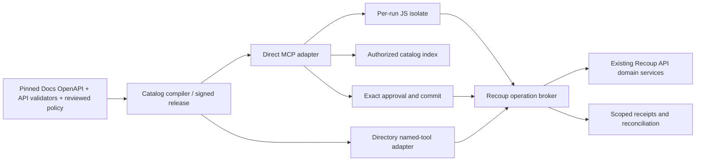

# Recoup MCP code mode

**Proposed technical specification · November 27, 2026 · [Delivery epic](https://github.com/recoupable/mono/issues/751)**

Give direct MCP clients two tools to discover and compose Recoup reads. Advertise a third tool when a connection can commit a qualified change. The host model writes ordinary JavaScript at request time. Recoup executes the program in an isolated service, validates each operation against the authenticated account and returns just the requested result. Recoup does not need a second model to translate a program into API calls.

Use one API-owned operation catalog to generate both this interface and the individually named tools that OpenAI reviews. Launch the proposed Directory profile with two useful catalog tools. Keep current connections on their existing URL until each supported workflow has a verified migration or an explicitly accepted disposition. This proposal covers the build, evidence required for a production cutover and submission for review.

| Read next | What it establishes |
| --- | --- |
| [Measured current architecture](mcp-code-mode-baseline.md) | Source pins, real SDK discovery across profiles, host inventory, product semantics and prior publisher work |
| [Code-mode research](mcp-code-mode-research.md) | Cloudflare, Anthropic and Executor source, host deferral, runtime alternatives and comparative evaluation |
| [Protocol and OpenAI review](mcp-code-mode-protocol.md) | Current MCP and extensions, negotiated capabilities, eight proposed reviewer scenarios, submission and updates |
| [Proposed tool descriptors](mcp-code-mode-tools.json) | Measurable example input/output contracts for a direct connection |
| [Delivery and dependencies](#delivery-and-dependencies) | Owning repositories, parallel work, release gates and GitHub issues |

## Decision and measurable outcome

Full delegated OAuth currently returns 95 descriptors, including one app-only entry. On the current protocol the compact list is 111,082 bytes or 31,971 reference tokens, of which 31,820 represent model-visible descriptors. The proposed read-only descriptors together occupy **3,779 bytes / 912 tokens**. Including the write descriptor gives **5,308 bytes / 1,277 tokens**, about **96.0% less descriptor text** than that full model-visible baseline. The 912/1,277 figures measure the checked-in design fixture, before serialization by the production SDK. They establish a size budget, not host prompt savings or task parity. Existing narrow OAuth already measures only 1,038 model-visible modern tokens. Evaluate it separately.

To reproduce the candidate measurement, load the JSON fixture and compactly serialize `{"tools": tools[:n]}` in stored order with UTF-8, no trailing newline, for `n=2,3`. Count using tiktoken 0.14.0, `o200k_base`. The current implementation used the same envelope and tokenizer. Include server instructions, preloaded resources/skills and host-added wrappers in the later actual startup measurement. Use the same host configuration, account, task and granted behaviors in paired tests. The [schema and size verifier](verify-mcp-code-mode.py) runs the contract cases and reproduces the proposed footprint. Keep the JSON as a single wire example so the measured object can be serialized directly. [Measured baseline and reproduction](mcp-code-mode-baseline.md)

| Distribution | Proposed route on api.recoupable.dev | Model and wire contract |
| --- | --- | --- |
| Direct, read-only | `/mcp/code` | Exactly `search` and `execute`. Native skills/resources use negotiated protocol methods. Text-only hosts can find permitted skills through search. |
| Direct, write-entitled | Same route | Exactly `search`, `execute`, `commit`. Only register commit when the caller can use at least one admitted mutation. No hidden fourth launcher. |
| OpenAI Directory | `/mcp/directory` | Initially `select_catalogs` and `select_catalog_songs` only. Each has its own reviewable schema, effect metadata and implementation. Introduce a separate catalog-read permission. The Directory endpoint cannot route to the guest, discover implementation IDs, call commit or load skills that promise unavailable functionality. |
| Existing installs | `/mcp` and the existing staff skills endpoint | Preserve current authentication, scopes, gallery, legacy names and selected-context behavior. The existing thread launcher and app-only sidebar count separately. Qualify their replacement independently before retiring those entry points. |

Both new URLs are proposals under the established MCP mount. Business REST endpoints retain their /api paths. Keep scheme, host and port for the Directory publisher. Profile routing is a server decision bound to the endpoint and expected OAuth resource. Ignore brand strings as authorization selectors. A discovered operation is a description, never permission to call it. OpenAI requires separately exposed model-callable operations for Directory review. Recoup previously split its opaque Context tool into named operations after a scan. Changing the same endpoint under an existing publisher draft would risk both review and installed clients. [OpenAI §6.2](https://developers.openai.com/plugins/plugin-guidelines#62-tool-independence-and-exposure) · [Recoup's prior review fix](https://github.com/recoupable/api/pull/980)

## Alternatives and cutover strategy

| Option | Strength | Decision |
| --- | --- | --- |
| Keep named tools and use lazy host discovery | Minimal server migration. Preserves action-specific schemas, built-in confirmation and UI. | Ship named tools for Directory. Benchmark native deferral on supported clients. Direct clients need portable composition and bounded intermediate results. |
| Search, then register named tools dynamically | Fast single-step calls in cooperative clients. | Catalog changes can race across calls and vary by host. Adds discovery state and leaves multi-step results in the prompt. |
| Two generic tools calling arbitrary REST paths | Small interface. Easy to generate from OpenAPI. | REST authentication, side effects and output semantics differ from delegated MCP. A path allowlist cannot express selected context, quoting or response projection. |
| One broad execute tool for reads and writes | Smallest list, single program per workflow. | Host prompts cannot distinguish a catalog read from a send. Exact consent, failure recovery and keeping reads usable justify an optional third tool. |
| Direct mode with typed code, separate exact commit and a named Directory projection | Fixed-size bootstrap with independent auth, guest, business operations and publication. | **Adopt.** Costs include operating an isolate service, maintaining contract mappings and qualifying each client. A generated catalog and release gates bound that cost. |
| Adopt Executor as the platform, translate everything to CLI, or run another LLM inside MCP | Rapid access to a broad framework or familiar developer surface. | Executor's discovery/dispatch design is applicable. Its account, deployment and distribution model would duplicate Recoup's. CLI/inner-model approaches add shell or model dependencies to ordinary MCP clients. |

Use parallel opt-in URLs, with independent flags by profile, operation and cohort. Compare equivalent reads with test fixtures or consented canaries. Never shadow a write, paid provider call, secret read or outbound delivery. A big-bang swap at `/mcp` would strand installed hosts, invalidate the publisher contract and obscure regressions.

## Components and ownership



**Catalog compiler, API repository.** Compile approved descriptors and server-only bindings during CI. The Docs repo owns the split OpenAPI files, operation IDs and operation inventory. Pin the Docs commit, its upstream API source commit and hashes, then reconcile with the API build's actual routes, validators and services. The inspected Docs revision classifies 442 method/path rows in its source inventory and pins 14 specification hashes. The rows include 217 public, 17 public/integration, 177 internal, 13 internal/callback, 14 pending and four legacy entries. The static registration inventory has 75 entries, a separate measure from the 95-item full OAuth discovery response. Never enable a capability merely because Docs documents a route. Refresh drift as a proposed catalog diff requiring review. [Docs inventory](https://github.com/recoupable/docs/blob/873a1c93cf6ae0060702e38eba1b2715bb269f42/content/docs/contracts/operation-inventory.json) · [Docs publication workflow](https://github.com/recoupable/docs/blob/873a1c93cf6ae0060702e38eba1b2715bb269f42/AGENTS.md) · [Related capability-manifest work](https://github.com/recoupable/app/issues/2223)

**Versioned operation record.** Each record has a stable domain ID, public aliases, owner, revision, title, search terms, typed input, validated output and short example. The private binding selects a specific REST operation ID or shared domain method, HTTP serialization when needed, authorized identity and resource resolvers, selected-context projection, field mask, processor and destination classes, effects including delayed effects, budget/quote rules, idempotency, async lifecycle and per-profile disposition. A multiplexed REST operation needs an action-specific binding with a fixed discriminator. Link each published operation and legacy alias to contract tests. Emit per-profile manifests, TypeScript declaration snippets, searchable summaries and Directory descriptors as projections of that one record.

**Runtime release.** Content-address the manifest using canonical JSON over the API/Docs pins, schemas, bindings and policy. Sign it in CI, verify before serving, and record the digest on calls and receipts. Keep immutable revisions available for lookups and in-flight reconciliation. Changing a decision from allowed to denied takes effect immediately, even on an older pinned revision. A request with a retired schema returns `catalog_changed` with a rediscovery instruction. Keep aliases for backward-compatible changes, and use a new operation version for incompatible inputs, outputs or effect semantics. Include the old/new diff in approval and Directory review. No network fetching of arbitrary schema references at runtime.

**Operation broker, API repository.** Both profiles invoke the same business code. Prefer a typed in-process service invocation after the route's and profile's authorization/ownership checks have been composed. A fixed-origin HTTP binding is acceptable where the owning API supports the precise audience, identity, scope and effect contract. Resolve method, path and allowed headers server-side. Pass no host-managed MCP bearer to REST. Do not mint an account API key, assign a caller-supplied owner ID or substitute an admin credential. Refactor a handler into an authorized service or leave its operation unavailable if these conditions cannot be met.

**Runner.** Qualify an isolated Cloudflare Dynamic Worker first. Keep the front door, authentication, sensitive projections, approvals, receipts and business services in Recoup's API. The supervisor gets a short-lived, single-run channel to the broker, mutually authenticated and bound to the request, release and budget. Only the supervisor holds channel credentials. The guest sees two host functions and structured-cloned values. It gets no OAuth/session tokens, raw HTTP client, network, file access, environment, dynamic module loading, shell or database connection. Apply the platform's outbound-deny configuration at instantiation. The private broker accepts a typed RPC and a current run binding only. Review third-party processing, region, retention and contractual suitability for every data class crossing this boundary. If the first runner fails a hard gate, benchmark a per-run Vercel Sandbox through the same port. Keep launch off until one adapter meets the gates. [Runtime comparison and primary sources](mcp-code-mode-research.md)

## Interaction contract

`search` accepts a natural-language query, exact ID or page cursor. Each result has an id, summary and effect. Operations carry read or write, while skill material carries instruction. Requested contract sections and skill files use the optional bounded detail object. An exact lookup supplies input, output, one runnable example, authorization prerequisites, cost, pagination and revision. Rank exact IDs and aliases first, then domain terms and deterministic lexical matches. Add semantic reranking only if a measured query set improves without leaking unauthorized metadata or regressing exact matches. Limit summaries to eight and 4 KiB per response. Exact schemas may page by section at 12 KiB. A signed cursor binds selection, query, principal, policy and expiry. Reject mixed modes and invalid file paths. Skill fallback resolves only accessible skill IDs/files using the existing audience resolver. Use the same denial for hidden and unknown IDs.

`execute` accepts a pinned revision, JS source and separately encoded JSON parameters. The source is an async function with the signature `(recoup, params) => Promise<Json>`. It may compose reads, branch, map, group and return a projection. The guest API exposes `read(id, args)` and `prepare(id, args)`. Neither can cause a business write. Running with only a `runId` reads the caller's authorized durable receipt. The host adds trace, truncation and outcome metadata outside the guest. Ordinary completed reads require no persisted account artifact. Modern/legacy adapters validate output schemas and supply a small text fallback. Oversized outputs fail with a narrowing instruction or explicitly indicate partial coverage. Never silently claim complete coverage of partial pages.

For example, an account asks for the first five track titles in one of its catalogs. Searching for “my catalogs and track list” yields the qualified metadata projections below. The model can combine them without putting the catalog rows in the chat. The account has already selected a catalog ID. Display names can collide across organizations. These IDs and normalized fields are **proposed**; the existing MCP matcher has a different contract.

```js
async (recoup, params) => {
  const { catalogs } = await recoup.read("catalogs.listOwned", { ids: [params.selectedCatalogId] });
  const catalog = catalogs.find(item => item.id === params.selectedCatalogId);
  if (!catalog) return { found: false, tracks: [] };
  const page = await recoup.read("catalogs.listTrackMetadata", { catalogId: catalog.id, limit: 5 });
  return { found: true, tracks: page.tracks.map(track => track.title), hasMore: page.hasMore };
}
```

The proposed ID filter returns only owned matches and can be applied before paging. For an initial name-only request, page the authorized list and ask for a choice if multiple catalogs match. Test duplicate names and later-page matches. The catalog owner path is derived from the connection. The track metadata binding checks catalog access before fetching a page and only returns approved metadata. The proposed Directory matcher instead accepts a brief, can send metadata to a known AI processor and returns actual matching tracks from a bounded search window. It needs its own adapter, privacy disclosure and qualification. Each named Directory operation works independently for an authorized account. [Current mapper](../../lib/mcp/tools/catalogs/registerGetCatalogSongsTool.ts)

`commit` takes one opaque intent plus a request key, never code or replacement arguments. A pure preview canonicalizes a single operation and its complete arguments into an encrypted, authenticated, expiring intent. When preparing an intent, measure the canonical arguments (4 KiB maximum) and the sealed base64url intent (8 KiB maximum) before issuing it. After the guest returns, the supervisor verifies that the entire projected result fits the separate 16 KiB cap before sending it to the host. Reject an oversized preview response without starting a change. Return intent_too_large with narrowing guidance if any bound fails. Test incompressible near-limit arguments and confirm each issued intent round-trips unchanged. It binds actor, client/grant, selected resource, audience, operation and schema/policy revisions, destination, quote or spending ceiling and input hash. Return a separately derived human-readable summary. A quote that reserves credits, writes state or contacts a provider needs its own classified operation; it cannot masquerade as a pure preview. With no trusted consent, record a minimal pending receipt and return an authenticated confirmation URL with `approval_required`. With modern elicitation negotiated the adapter may instead return the protocol-level `resultType: input_required` carrying bound request state. On resumption verify the independently recorded approval and payload. The app shows the exact target, before/after change, recipients, data sent, amount and expiration. Bind approval in Recoup after account sign-in. The broker constructs the confirmation URL from a release-pinned HTTPS Recoup origin, a fixed approval path and the encoded server-issued run ID. For production the proposed form is `https://chat.recoupable.dev/mcp/approvals/{runId}`. Before emitting any approval URL in either tool, verify exact equality with the server-built URL for the authenticated receipt. The confirmation route disallows redirects, arbitrary destinations and return URLs. The portable descriptor describes a string; the broker validates this deployment-specific URL contract. Possession of a URL or model-generated approval text is insufficient. On a subsequent commit, atomically claim the approved intent, recheck authority and quote, and dispatch **only that recorded operation**. The original program never resumes with permission to perform a different write.

For the write-capable descriptor fixture the generic commit has conservative destructive/open-world hints for a profile that includes those admitted effects. Generate the actual flags from the union of reachable effects per profile, including narrowing them for an additive-only pilot. Keep `execute` closed-world during the first release. A new outbound data path requires a separately reviewed disclosure and information-flow rule. Code that reads private files cannot forward them through a public search, URL-bearing argument, provider prompt or external recipient in the same run. The pilot enforces this by omitting such destinations from the read bridge and denying disallowed fields at input and projection time. Qualify additional data routes and their new descriptor annotations before enabling them.

### Large results, media and extensions

A modern client can receive a structured result, a scoped resource link or an existing host attachment when its adapter supports the type. Keep binary media, private audio, fan contacts, provider dataset IDs and service credentials out of the default JS projection. For a private artifact return an opaque reference bound to actor, grant, resource class and expiry, with a documented MIME type and retrieval limit. Validate access again on dereference. Legacy text-only hosts receive a bounded summary and an authorized follow-up path. Never fall back from a private file to a public media URL. A directory or skill resource cannot execute an operation or broaden a grant. Keep the existing gallery on its qualified profile until supported thread/sidebar behavior, CSP and scoped assets survive installation tests. Native Tasks and streaming can improve UX later without changing Recoup run IDs or persistence.

## Budgets, lifecycle and failure behavior

| Proposed initial bound | Enforcement point |
| --- | --- |
| Source 8 KiB UTF-8, params 16 KiB, depth 16; catalog summaries 4 KiB; guest result 16 KiB | HTTP front door counts bytes before parse; broker checks structured payloads before copying. Schema `maxLength` is only an additional character bound. Cap cumulative data returned to guest at 256 KiB per run. |
| 16 nested calls, two simultaneous reads, one effect per commit | Atomic supervisor counters on every call, including rejected attempts and paginated reads. Derive per-account/provider quotas from existing limits. |
| 10 s wall time, 100 ms guest CPU and an enforced provider memory ceiling, starting target 128 MiB | Hard-stop guest and close callback channel. Qualify actual platform ceilings, cancellation and tail behavior under contention. Allocate broker I/O and processor budgets independently. |
| 5 min preview validity, earlier of domain quote or grant expiry | Enforce on prepare, human approval and commit. Scope status handles to actor and grant; a handle never grants access. |
| Sensitive logs | Only trace ID, hashed/opaque tenant and operation identifiers, policy/manifest revision, byte counts, durations, budget, outcome and receipt reference. Omit source, arguments, credentials, prompts, results and raw upstream errors by default. |

Model authentication and human approval as distinct authorities. Check grant, client, resource, current membership, feature flags, document ownership and profile on **every** broker call, readback and commit. Share only immutable public artifacts in global caches. Key private query/cursor caches by profile, principal/grant, selected workspace and policy revision. Keep selected-context and narrow OAuth restrictions even on guessed IDs. The existing protected resource uses the exact `/mcp` audience. New routes need their own resource metadata, explicit approved scopes, issuance and agreement on callback paths. Require deliberate reauthorization. The first direct and Directory pilots accept only explicitly consented, audience-specific OAuth. Propose a catalog-read scope for the initial reads. The Directory grant cannot call /mcp/code. Write-enabled direct pilot accounts need a separately consented, admitted write scope. Legacy API-key/Privy, broad or narrow /mcp grants, selected-context and staff credentials stay on their current routes. Future standard-credential opt-in requires a documented audience/profile entitlement and isolated tests. A new scope for a Directory reader never upgrades an existing narrow grant. [Current resource metadata](../../lib/oauth/getOAuthResourceMetadata.ts) · [Full delegated checks](../../lib/mcp/oauth/registerFullOAuthTools.ts)

Persist only the data necessary to apply or reconcile a write. Use Supabase via its existing repository layer. Define receipt rows with `run_id`, actor/grant/profile, operation/release, intent digest, request key, lease and timestamps, approved ceiling, state, safe result digest/reference, downstream idempotency handle and outcome evidence. Use a unique key for the intent claim as well as the actor/profile/request-key binding. Same key+digest returns the prior receipt; same key+different content conflicts. Distinct keys cannot consume the same intent twice. Atomically claim/record the ledger and enqueue an outbox entry for service dispatch. Immediately before a queued worker actually dispatches, revalidate grant, membership, kill switch, destination, quote, approval and remaining budget against the claimed receipt. If any expired during queueing, terminally deny or expire it without an external effect. Test revocation and quote expiry after enqueue. Integrate existing domain transaction/idempotency keys where available. If the upstream cannot deduplicate, a worker crash after dispatch enters reconciliation; never automatically replay that submission.

Status advances from approval to accepted, running and succeeded/failed. A timeout after dispatch yields `unknown_outcome` with a handle. An independent status read resolves it when evidence exists; otherwise retain it for operator reconciliation. An aborted script stops new work. A cancellation after an upstream commit returns known effects. A downstream Recoup REST 202 denotes job acceptance. The MCP tools/call still returns a JSON-RPC result carrying a run handle. A transport-level HTTP 202 without a body acknowledges a notification or response, not an asynchronous tools/call. Long operations use an existing domain job or a Vercel Workflow and an authorized status projection. Never keep a JS isolate resident during human confirmation, long media generation or durable polling. Optional MCP Tasks can project the same underlying receipt for capable clients. Use existing workflows instead of adding Trigger.dev jobs. Define an expiry for payloads, receipts and redacted audit metadata with the product/privacy owner before rollout, and preserve required idempotency records for the entire allowed retry window.

Return structured domain failures with a bounded `code`, `traceId`, retry guidance and a receipt when available. Distinguish invalid arguments, changed catalog, unknown-or-denied operation, expired approval, budget exceeded, upstream busy, partial coverage and unknown outcome. Use MCP tool errors for domain failures and JSON-RPC/HTTP errors for malformed protocol and authentication. For search and failures before a valid result envelope exists, return isError with one bounded JSON text block containing code, retry and traceId. In execute/commit structured results, put code and retry under error. Require runId for approval_required, accepted, running and unknown_outcome. Status reads return the same receipt-state names as commit; complete and partial describe successful guest computations. Include the Recoup-owned approval URL in approval_required fallback results from both commit and receipt reads. A complete guest computation returns a value and truncated=false. The supervisor reports partial when it removes rows or cannot establish coverage; truncated=true always implies partial. A source page with hasMore may still fully answer an explicitly bounded first-page question. Back off and retry a read within its remaining deadline. Never retry an ambiguous external write based on a 5xx alone. If the runner fails, surface unavailable and keep eligible cohorts on their prior connection. Do not fall back to a broader credential or endpoint.

## Qualification, release and expansion

**Test design.** Use test-first domain work and fixtures seeded in two isolated accounts and organizations. Exercise reference resolution, unions, strict schemas, empty results, tenant/role changes, pagination, malformed/oversized programs, quota exhaustion, caller cancellation and new-revision behavior. Compare canonical outputs and effects against the old operation, including “read” calls that can settle a pack, quoted social refresh, restricted recipients, private file handles and scheduled downstream costs. Keep identity-bearing data out of release evidence. Capture installed client name/version, resource audience, tool list, operation/revisions, actual outcome, and independent readback for writes. Benchmark entirely on synthetic or authorized disposable fixtures.

**Proposed release gates.** Measure at least 30 paired runs per task class and model/host treatment where automation is available. Keep seed, model release, prompt, host version, tool selection mode, temperature or supported equivalent, selected grant and data constant. Expand the sample when the interval cannot resolve a gate. Include single reads, empty/unknown, two-step discovery, paged joins, selected context, skill reads, a denied operation, one confirmed mutation, replay and long-job status. Use matched legacy/host-deferred baselines and include failures in all summaries.

| Gate | Proposed acceptance |
| --- | --- |
| Startup | At most 1,500 descriptor tokens for the write-capable direct profile, at least 90% below full OAuth's model-visible reference list. Verify actual first-turn token delta on controlled hosts and report measured vs unavailable separately. For a narrow/deferred client already below that target, require no material startup or task-success regression before migrating. |
| Correctness | All deterministic authorization, projection, approval, idempotency and cross-tenant tests pass. Zero unauthorized effects, duplicate writes or credentials in output. Every admitted workflow passes normal-entry E2E with independent outcome evidence. A failed boundary test disables the operation. |
| Model utility | On core tasks, paired success lower 95% confidence bound for candidate minus best applicable baseline ≥ −5 percentage points. Flag each critical task class independently. Human checks for false licensing claims and fabricated tracks. |
| Efficiency | In multi-step reads target ≥30% less median total model-visible token traffic, direct vs eager named. Show deferred baseline too. On single reads target ≤20% p95 wall-time regression and ≤10% higher median cost per correct task vs best compatible baseline. Record cold/warm runtime, processor calls, cache hits and approval latency separately. Hold a default change when cohorts miss targets. |
| Operability | Test failure injection before/after admission, revocation mid-run, stopped runner and restart after dispatch. On a controlled deployment exercise per-operation disable, per-profile rollback and recovery of existing receipts. Establish p95 and cost alarms from measured baselines. |

**Adoption sequence.** Deploy dormant catalog, broker and additive storage. Verify descriptors on a preview. Enable read-only direct for internal disposable accounts; then canary qualified cohorts at 1%, 10%, 50%, 100%, with enough successful journeys and a full monitoring window at each stage. Introduce one disposable additive write after the ledger, confirmation and readback tests pass. Expand operation families according to measured use and risk, retaining named support for gaps. Keep first-party native chat and existing transcripts working on their established paths. An OpenAI reviewer receives the separately staged named profile. Recoup's direct launch can proceed independently of the publisher's review decision.

**Rollback and retirement.** On an isolation, billing, duplicate-effect or cross-account failure, immediately disable the affected operation/profile, stop new dispatch, quarantine uncertain receipts and keep reconciliation available. Preserve older manifests, client settings, old route and status reads. Roll forward schema or policy fixes under a fresh revision. Before communicating an end-of-life date, require a disposition for every old name/shape/client, usage evidence over a proposed 30-day window, host-owner signoff and a working reconnect/restore runbook. Low usage alone does not establish parity. Keep unsupported hosts on legacy if needed. Record rollout, deprecation, review submission, approval and publication as separate milestones.

**Adding a capability after cutover.** A maintainer lands the Docs contract, pins its API binding, adds or changes one operation record with ownership/effects, runs compiler and negative contract fixtures, and opens the generated catalog diff. The broker can then admit it per profile. Direct clients discover it on the next authorized search. A Directory addition generates an independent named descriptor and goes through the current review process. A new sandbox, model or protocol extension can be introduced behind the same contracts and evaluated against the same fixtures.

## Delivery and dependencies

| Ticket | Deliverable | Blocked by |
| --- | --- | --- |
| [api#1303](https://github.com/recoupable/api/issues/1303) | Baseline startup context and map every existing MCP operation to its consumers | Can start now |
| [api#1304](https://github.com/recoupable/api/issues/1304) | Compile a versioned operation catalog from Recoup contracts and admission policy | [api#1303](https://github.com/recoupable/api/issues/1303) |
| [api#1305](https://github.com/recoupable/api/issues/1305) | Bind MCP profiles and per-operation execution to the authenticated grant | [api#1303](https://github.com/recoupable/api/issues/1303) |
| [api#1306](https://github.com/recoupable/api/issues/1306) | Qualify an isolated JavaScript runner with a Recoup-only operation bridge | Can start now |
| [api#1307](https://github.com/recoupable/api/issues/1307) | Ship search and execute for a read-only direct MCP pilot | [api#1304](https://github.com/recoupable/api/issues/1304), [api#1305](https://github.com/recoupable/api/issues/1305), [api#1306](https://github.com/recoupable/api/issues/1306) |
| [database#144](https://github.com/recoupable/database/issues/144) | Persist actor-bound approval decisions and effect receipts atomically | [api#1304](https://github.com/recoupable/api/issues/1304), [api#1305](https://github.com/recoupable/api/issues/1305) |
| [api#1308](https://github.com/recoupable/api/issues/1308) | Add exact write previews, trusted approval, commit and reconciliation | [api#1307](https://github.com/recoupable/api/issues/1307), [database#144](https://github.com/recoupable/database/issues/144) |
| [app#2411](https://github.com/recoupable/app/issues/2411) | Migrate first-party chat, stored transcripts, Skills and gallery consumers | [api#1307](https://github.com/recoupable/api/issues/1307) |
| [api#1309](https://github.com/recoupable/api/issues/1309) | Generate the individually reviewed ChatGPT Directory catalog profile | [api#1304](https://github.com/recoupable/api/issues/1304), [api#1305](https://github.com/recoupable/api/issues/1305) |
| [api#1310](https://github.com/recoupable/api/issues/1310) | Benchmark model success, context, latency and cost across MCP designs | [api#1307](https://github.com/recoupable/api/issues/1307) |
| [mono#752](https://github.com/recoupable/mono/issues/752) | Qualify real MCP hosts, business behavior and the rollback drill | [api#1308](https://github.com/recoupable/api/issues/1308), [app#2411](https://github.com/recoupable/app/issues/2411), [api#1310](https://github.com/recoupable/api/issues/1310) |
| [docs#44](https://github.com/recoupable/docs/issues/44) | Publish versioned code-mode, named-tool and legacy migration guides | [api#1304](https://github.com/recoupable/api/issues/1304), [api#1305](https://github.com/recoupable/api/issues/1305) |
| [mono#753](https://github.com/recoupable/mono/issues/753) | Package and submit the qualified Recoup Directory profile for OpenAI review | [api#1309](https://github.com/recoupable/api/issues/1309), [docs#44](https://github.com/recoupable/docs/issues/44) |
| [mono#754](https://github.com/recoupable/mono/issues/754) | Roll out direct code mode and retire legacy cohorts with measured parity | [mono#752](https://github.com/recoupable/mono/issues/752), [docs#44](https://github.com/recoupable/docs/issues/44) |

The epic uses native GitHub sub-issues and blocking dependencies. The issues describe proposed owner roles, evidence and acceptance. API owns contracts, execution and the spec. Database owns persistence, App owns consumer compatibility, Docs owns public guides, and Mono coordinates qualification and release. The [existing OAuth epic](https://github.com/recoupable/mono/issues/207), [host matrix](https://github.com/recoupable/mono/issues/215), [MCP Apps work](https://github.com/recoupable/app/issues/2215) and [manifest work](https://github.com/recoupable/app/issues/2223) remain sources for the corresponding workstreams.

**First implementation slice.** Begin the baseline/parity inventory and runtime qualification in parallel. The first product demonstration is a real read-only host connection that finds two authorized catalog operations, runs the five-title example, and reports measured setup cost, permissions and output. The first write demonstration is separate and requires a recorded human approval and independent readback. The Directory milestone is an actual submission receipt for a qualified named-tool package.
